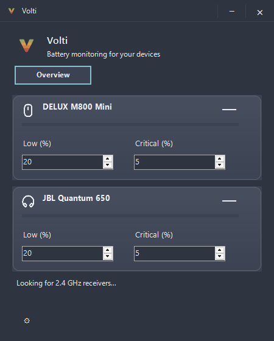

<p align="center">
  
</p>

# Volti

Volti is a small Windows system tray application that monitors battery levels from supported wireless mouse and headset receivers.

**Preview release · 0.1.0-preview.1**

## Features

- Separate mouse and headset tray indicators, tinted by battery percentage.
- Per-device low and critical battery notifications with configurable thresholds.
- Black, White, Gruvbox and Nord themes with matching battery colors.
- English and Brazilian Portuguese, selectable in Settings → Language.
- Optional startup through Windows Startup apps.
- Per-user installer, uninstaller and portable package.



## Compatibility

| Device | Connection | Implementation |
| --- | --- | --- |
| DELUX M800 Mini | Proprietary USB 2.4 GHz receiver | Receiver battery reports |
| JBL Quantum 650 | Proprietary USB 2.4 GHz receiver | HID feature query, approximately once per minute |

These implementations target specific receiver interfaces. Other models, firmware revisions, Bluetooth connections and generic wireless devices require separate validation. The original prototype returned battery values from these two devices. The preview packaging, language changes and non-elevated startup still need a complete hardware test before a stable release.

## Install and use

Download the [Windows installer](https://github.com/TutsGita/Volti/releases/download/v0.1.0-preview.1/Volti-0.1.0-preview.1-Setup.exe) from [Releases](https://github.com/TutsGita/Volti/releases). The installer places the application under the current user's Local AppData, adds a Start menu shortcut and offers optional desktop and startup shortcuts. Startup is off by default. Inno Setup is only needed to build the installer from source.

For portable use, extract the entire portable ZIP and keep `assets` beside `Volti.exe`.

Volti opens in the system tray. Double-click either device indicator to open the panel. Right-click an indicator to open the panel or exit. Closing the panel hides it in the tray. The gear at the bottom left opens Settings.

Each device card has **Low (%)** and **Critical (%)** limits. Critical must be lower than Low. Each warning level fires when the battery enters that range and rearms when the battery rises above it. Preferences are stored under `HKCU\Software\Volti`.

## Startup and permissions

The installer and app run with the current user's permissions. The optional startup entry is `Volti` under `HKCU\Software\Microsoft\Windows\CurrentVersion\Run`. Windows can independently disable startup entries through its Startup apps controls.

HID access depends on the receiver's permissions and availability. If the panel reports **Access denied**, test a manual elevated launch. A receiver that requires elevation cannot be assumed to work through ordinary non-elevated startup. Close conflicting manufacturer software when investigating access failures.

Older Pulso Duo scheduled tasks are only migrated when the startup setting is changed in the app. Removing an elevated legacy task may require one manual elevated launch. Keep the old app closed during migration.

## Build from source

Use Windows 10 or 11 with .NET Framework 4.8 installed. The build script uses the .NET Framework C# compiler included with Windows and references WinForms and System.Drawing. No NuGet packages are required.

```powershell
.\scripts\build.ps1
```

The output is `build\Volti\Volti.exe` with its required assets and notices. If your system blocks local scripts, review the script and use your organization's approved PowerShell execution policy.

To build the installer, install [Inno Setup 6](https://jrsoftware.org/isinfo.php) and run

```powershell
.\scripts\package.ps1 -IsccPath "C:\Program Files (x86)\Inno Setup 6\ISCC.exe"
```

Release files and SHA-256 checksums are written to `dist`. The source ZIP includes the application, assets, installer definition and build scripts.

## Roadmap

- Profile and reduce RAM usage, image allocations and tray icon refresh costs.
- Add device readers with explicit model and firmware compatibility records.
- Add more languages and move translations into dedicated resource files.
- Improve high-DPI scaling, keyboard navigation and screen reader support.
- Improve receiver reconnection and device discovery after USB changes.
- Validate non-elevated HID access on additional Windows installations.

These items describe future work and have no committed release dates.

## Current limits

- Supported receivers are discovered when the app starts. Restart after reconnecting a receiver.
- The interface currently uses a fixed-size layout.
- Card shading simulates a frosted surface through drawing, without background blur.
- Release executables are unsigned. Windows may show an unknown publisher or reputation warning.
- The application performs local HID reads and local preference storage. It includes no telemetry or automatic updater.

## License and credits

Volti source and build scripts use **GNU AGPL version 3 only**, identified as `AGPL-3.0-only`. The complete license is included in [LICENSE](LICENSE). Distributions should include the corresponding source or provide access to the matching source as required by the license.

MingCute device icons retain their Apache 2.0 license. Original SVGs, PNG derivatives and the upstream license are included. See [THIRD_PARTY_NOTICES.md](THIRD_PARTY_NOTICES.md).
