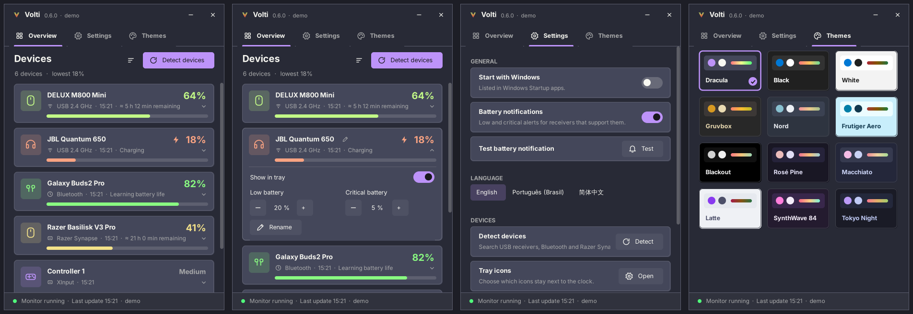

<p align="center">
  
</p>

# Volti

Volti is a small Windows system tray application that monitors battery levels from supported wireless mouse and headset receivers.

**Version 0.6.0**

See [the changelog](CHANGELOG.md) for release highlights.

The release provides a portable app, a Windows installer, matching source with the diagnostic toolkit, and SHA-256 checksums. See the [latest release notes](docs/release-0.6.0.md).

<p align="center">
  
</p>

## Features

- One tray indicator per device, tinted by battery percentage, with a hover preview.
- A resizable panel that lists every device on one card style: level, battery bar, connection, last reading and remaining time.
- Device options inline on each card: tray visibility, low and critical thresholds and renaming.
- A summary of how many devices report and the lowest level, with sorting by battery or name.
- Low and critical battery notifications with configurable thresholds for the DELUX and JBL receivers.
- Twelve themes, Dracula by default. Existing theme preferences are preserved.
- English, Brazilian Portuguese and Simplified Chinese, selectable in Settings → Language.
- Separate tray and panel processes. Closing the panel releases its process while monitoring continues.
- About 60% lower private RAM use in tray-only mode compared with keeping both processes open, measured locally.
- Bluetooth battery discovery through Windows device properties, refreshed every minute.
- Razer battery and charging indicators from local Synapse 3/4 logs.
- Per-device tray visibility controls and manual USB and Bluetooth detection.
- Optional startup through Windows Startup apps.
- Per-user installer, uninstaller and portable package.

## Compatibility

| Device | Connection | Implementation |
| --- | --- | --- |
| XInput wireless controllers | Windows XInput | Empty, low, medium or full when the controller reports a supported battery type |
| DELUX M800 Mini | Proprietary USB 2.4 GHz receiver | Receiver battery reports |
| JBL Quantum 650 | Proprietary USB 2.4 GHz receiver | HID feature query, approximately once per minute |
| Attack Shark R1, X6, X11, X11 SE, DELUX M600 Pro | USB 2.4 GHz receiver | Passive percentage reports, identified by report model byte |
| Rapoo MT760 Mini | USB 2.4 GHz receiver | Passive percentage reports when Rapoo software requests a reading |
| JBL Quantum 910 Wireless | USB 2.4 GHz receiver | Passive percentage reports when the headset emits a battery event |
| HyperX Cloud Stinger 2 Wireless | USB 2.4 GHz receiver (03F0:0D93) | HID battery percentage |
| HyperX Cloud Stinger Core Wireless | USB 2.4 GHz receiver (0951:170B, 03F0:0A93 PlayStation, 03F0:0A8E DTS) | Estimated percentage from headset voltage |
| HyperX Cloud Stinger Wireless (PS4 original) | USB 2.4 GHz receiver (0951:16DA) | Receiver detection, battery protocol pending |
| HyperX Pulsefire Haste 2 Wireless | USB 2.4 GHz receiver (03F0:0D97, 03F0:0F98) | Experimental HID percentage, physical validation pending |
| Razer wireless peripherals reporting battery in Synapse | Synapse 3 or 4 | Local log percentage and charging state, no fixed model list |

The new USB readers appear after a valid percentage arrives and retain the last reported value until the receiver disconnects. Model and protocol references are credited in [THIRD_PARTY_NOTICES.md](THIRD_PARTY_NOTICES.md). These new readers are pending validation with physical devices in Volti. Cable presence by itself never creates a battery indicator.

The original Cloud Stinger Wireless for PS4 (HX-HSCSW-BK; Kingston receiver 0951:16DA) is detected. Battery readings for this receiver are pending protocol verification.

The HyperX readers run at launch, once per minute, and on **Detect devices**. They use the device’s own USB receiver. The original Stinger has an explicit card when connected, with a dash until its battery can be read.

Keep Razer Synapse running to update its logs. Volti checks them every 30 seconds and on **Detect devices**, preferring a usable Synapse 4 snapshot. Readings expire after 15 minutes when the log or event timestamp is old. The Synapse reader was tested with synthetic logs. Physical device verification is pending.

USB receiver readers target specific device interfaces. Bluetooth support reads battery percentages exposed by Windows device properties. Devices that do not expose that property require another reader. End-to-end Bluetooth battery validation on a compatible physical device remains pending.

## Install and use

Download the [Windows installer](https://github.com/TutsGita/Volti/releases) from [Releases](https://github.com/TutsGita/Volti/releases). The installer places the application under the current user's Local AppData, adds a Start menu shortcut and offers optional desktop and startup shortcuts. Startup is off by default. Inno Setup is only needed to build the installer from source.

For portable use, extract the entire portable ZIP and keep `assets` beside `Volti.exe`.

Volti opens the panel on the first manual launch and can monitor in the tray afterward. Hover over a device icon for a battery preview and click it to open the panel. Right-click an indicator to see every reading, open the panel or exit. Closing the panel terminates Volti.UI.exe while Volti.exe continues monitoring.

The panel has three tabs: Overview, Settings and Themes. Click a device card, or press Enter on it, to show its options. Use the pencil beside a device name, or F2, to set a local alias. The window can be resized and remembers its position. Keyboard shortcuts: F5 detects devices, Ctrl+1 to Ctrl+3 switch tabs and Ctrl+Tab moves to the next tab. The status bar shows whether the monitor is running and when the last reading arrived. If the monitor exits, the panel offers **Start monitor**.

Run `Volti.UI.exe --demo` to open the panel with sample devices, without a monitor or hardware.

The monitor learns discharge speed per device and stores its summary in `%LOCALAPPDATA%\Volti\battery-history.json`. Estimates appear after about five percentage points of discharge and ten minutes of observations. Charging, rising levels and long gaps start a new interval. Stable readings are kept in memory. The app saves learned discharge rates in batches at least five minutes apart during monitoring, and flushes pending changes on exit. It keeps up to 128 learned device summaries and caps each history file rewrite at 64 KiB. Devices that report only a status such as Low or Full show that status.

Opening Volti checks the latest stable release on GitHub. The prompt shows the version and highlights from the release notes. Accepting downloads the setup, verifies it against the release's SHA256SUMS.txt and restarts Volti in the same directory. Portable updates use the same setup in portable mode.

The DELUX and JBL receiver cards have **Low (%)** and **Critical (%)** limits. Bluetooth cards currently show battery level and tray visibility. Critical must be lower than Low. Each warning level fires when the battery enters that range and rearms when the battery rises above it. Preferences are stored under `HKCU\Software\Volti`.

## Startup and permissions

The installer and app run with the current user's permissions. The optional startup entry is `Volti` under `HKCU\Software\Microsoft\Windows\CurrentVersion\Run`. Windows can independently disable startup entries through its Startup apps controls.

HID access depends on the receiver's permissions and availability. Battery indicators require valid readings. A receiver that requires elevation cannot be assumed to work through ordinary non-elevated startup. Close conflicting manufacturer software when investigating access failures.


## Build from source

Use Windows 10 or 11 with .NET Framework 4.8 installed. The build script uses the .NET Framework C# compiler included with Windows and references WinForms and System.Drawing. No NuGet packages are required.

```powershell
.\scripts\build.ps1
```

The output contains `build\Volti\Volti.exe` and `Volti.UI.exe` with their required assets and notices. Keep both executables together. If your system blocks local scripts, review the script and use your organization's approved PowerShell execution policy.

To build the installer, install [Inno Setup 6](https://jrsoftware.org/isinfo.php) and run

```powershell
.\scripts\package.ps1 -IsccPath "C:\Program Files (x86)\Inno Setup 6\ISCC.exe"
```

Run `./scripts/test.ps1` on Windows to check the receiver, HyperX, JBL and Synapse parsers, remaining-time learning, alerts, update parsing and translations. On Linux or macOS with Mono, `./scripts/check.sh` compiles both executables with the same C# 5 language level as the Windows compiler and runs the same checks.

### Source layout

| Folder | Built into | Contents |
| --- | --- | --- |
| `src/Shared` | both | Settings, themes, translations, snapshot link, battery history, device model, updater, drawing helpers |
| `src/Monitor` | `Volti.exe` | Tray icons, alerts, USB/HID, HyperX, Bluetooth, XInput and Synapse readers |
| `src/Panel` | `Volti.UI.exe` | Panel window, device cards, settings, themes and the demo connection |
| `assets/lang` | both | Translations, one JSON file per language, keyed by the English text |
| `tests` | test runner | Parser and state checks |

Release files and SHA-256 checksums are written to `dist/release/<version>`. The source ZIP includes the application, assets, installer definition and build scripts.

## Roadmap

- Profile and reduce RAM usage, image allocations and tray icon refresh costs.
- Add device readers with explicit model and firmware compatibility records.
- Add more languages.
- Extend alerts to Bluetooth, Synapse and other discovered devices.
- Improve per-monitor DPI scaling and screen reader support.
- Validate non-elevated HID access on additional Windows installations.

These items describe future work and have no committed release dates.

## Current limits

- Volti discovers receivers at startup, after USB hardware changes, and every minute. Use Detect devices to retry immediately.
- Low and critical alerts cover the DELUX and JBL receivers. Other devices show their level without alerts.
- Layout sizes scale with the primary display's DPI when the panel opens.
- Release executables are unsigned. Windows may show an unknown publisher or reputation warning.
- The application performs local HID reads and local preference storage. It includes no telemetry. The update check contacts the GitHub API when Volti starts or the panel opens.

## License and credits

Volti source and build scripts use **GNU AGPL version 3 only**, identified as `AGPL-3.0-only`. The complete license is included in [LICENSE](LICENSE). Distributions should include the corresponding source or provide access to the matching source as required by the license.

MingCute device icons retain their Apache 2.0 license. Original SVGs, PNG derivatives and the upstream license are included. See [THIRD_PARTY_NOTICES.md](THIRD_PARTY_NOTICES.md).

On Windows 11, right-click a Volti tray icon and choose **Windows taskbar settings** to manage whether those icons appear outside the overflow menu. You can also drag a Volti icon out of the overflow, then position it next to Quick Settings.
